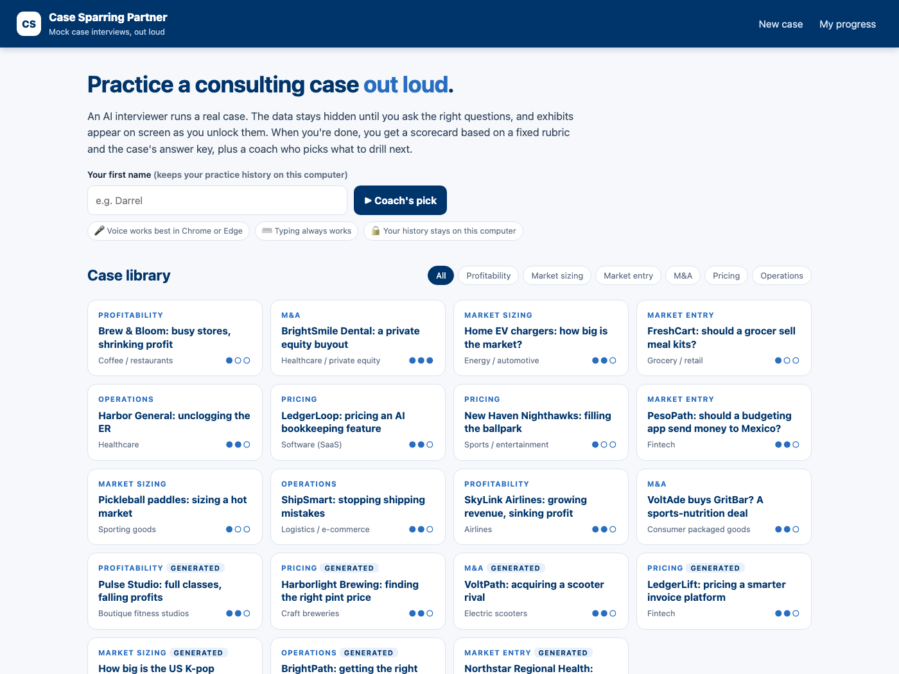

# Case Sparring Partner

**Practice consulting case interviews out loud, with an AI interviewer that keeps the data hidden until you ask
the right questions, then grades you on a fixed rubric checked against an answer key.**

MGT 409 · AI Foundations for Managers · Final project by Darrel Choi · Repo: https://github.com/darrelchoi/case-sparring-partner



## What it does

1. **Interviewer agent** runs a live case (by voice in Chrome, or by typing). It never sees the case data. It
   only gets a list of topics and reveals a fact through a tool when you ask about it. Exhibits (charts)
   appear on screen as you unlock them.
2. **Grader agent** scores you on 6 dimensions (structure, clarifying, math, judgment, synthesis,
   communication) with a quote from your answers for each. **Python** checks the quotes and grades the math
   against the answer key. The AI can't overrule it.
3. **Coach agent** reads your history, names a pattern, gives a 10-minute drill, and picks your next case.
4. **Case Generator agent** writes new original cases. Python recomputes every number before a case is used.

12 original library cases cover profitability, market sizing, market entry, M&A, pricing and operations.

## Run it (about 3 minutes)

You need **Python 3.11 or newer** and a `PORTKEY_API_KEY` (the course key, model `gpt-6-luna`).

```bash
# 1. from inside this folder
python3 -m venv .venv
source .venv/bin/activate            # Windows: .venv\Scripts\activate

# 2. install
pip install -r requirements.txt

# 3. API key: put a .env file EITHER in this folder OR in the folder above it, containing
#    PORTKEY_API_KEY=...        (see .env.example)

# 4. start
python run.py                        # opens http://localhost:8000
```

Open it in **Google Chrome** (or Edge) for voice. Other browsers work with typing only. During a case, pick the
interviewer's voice from the **Voice** menu (▶ plays a sample). The default is a calm female voice. If port 8000 is
busy: `python run.py --port 8010`.

### Try it in 2 minutes

Type your first name → click **Pickleball paddles** (easy) → ask clarifying questions → say your framework →
ask for data ("How many people play pickleball?") → do the math out loud → give a recommendation → press
**I'm ready to be graded**. Then open **My progress** and press **Review** on the case.

## Useful scripts (all optional)

| Command | What it does |
|---|---|
| `python scripts/hello.py` | One test call; prints token usage |
| `python scripts/validate_cases.py` | Checks every case and recomputes its math |
| `python scripts/cli_interview.py brew_bloom` | Run a case in the terminal |
| `python scripts/cli_interview.py harbor_er --script scripts/sample_answers/harbor_er_strong.txt` | Scripted demo run |
| `python scripts/generator_test.py` | Generate 6 cases, report what the math checker caught |
| `python scripts/cost_report.py` | 5 full cases → `output/cost_report.md` (tokens, cost at scale, compression test) |
| `python scripts/safety_tests.py` | 9 attacks with defenses off vs on → `output/safety_results.md` |
| `python scripts/safety_tests.py --offline` | The 4 code-level safety tests, no API calls |

## Project layout

```
app/            main.py (FastAPI) · orchestrator.py · guards.py · usage.py · llm.py · models.py · cases.py
app/agents/     interviewer.py · grader.py · coach.py · generator.py
prompts/        instructions for each agent
static/         the web app (HTML/CSS/JS, Chart.js + browser speech APIs, no build step)
cases/          12 library cases (JSON) + generated/
data/           rubric.json · prices.json · history.json (your practice history, created on first use, gitignored)
scripts/        test, cost, and safety scripts + sample_answers/
output/         usage_log.jsonl · cost_report.md · safety_results.md · generator_report.md · runs/ · screenshots/
report.html · slides.html
```

## Cost and safety, in one line each

- A full case costs about **$0.002** (about 80% of input tokens come from cache), which is about **2.4¢ per user per month**. See `output/cost_report.md`.
- Input guard, hidden-data design, leak filter, Python-checked grading, reveal caps, per-turn/case/day
  spending caps, off-topic limit: **9/9 safety tests pass**. See `output/safety_results.md`.

Privacy: in Chrome, voice input is turned into text by Google's speech service. Practice history stays on this
computer in `data/history.json` (delete it from **My progress**).
